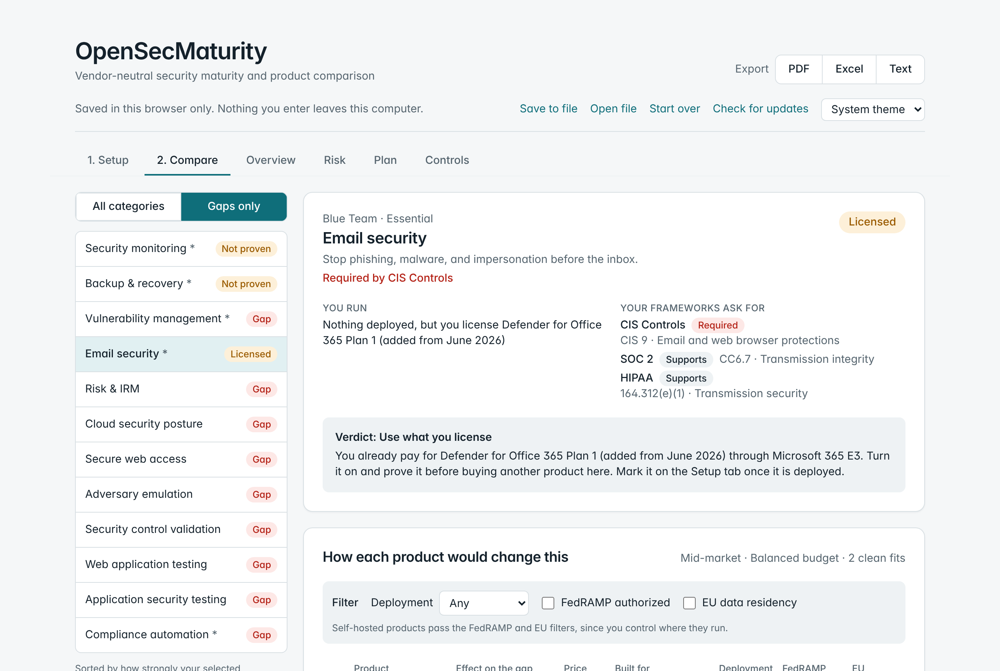
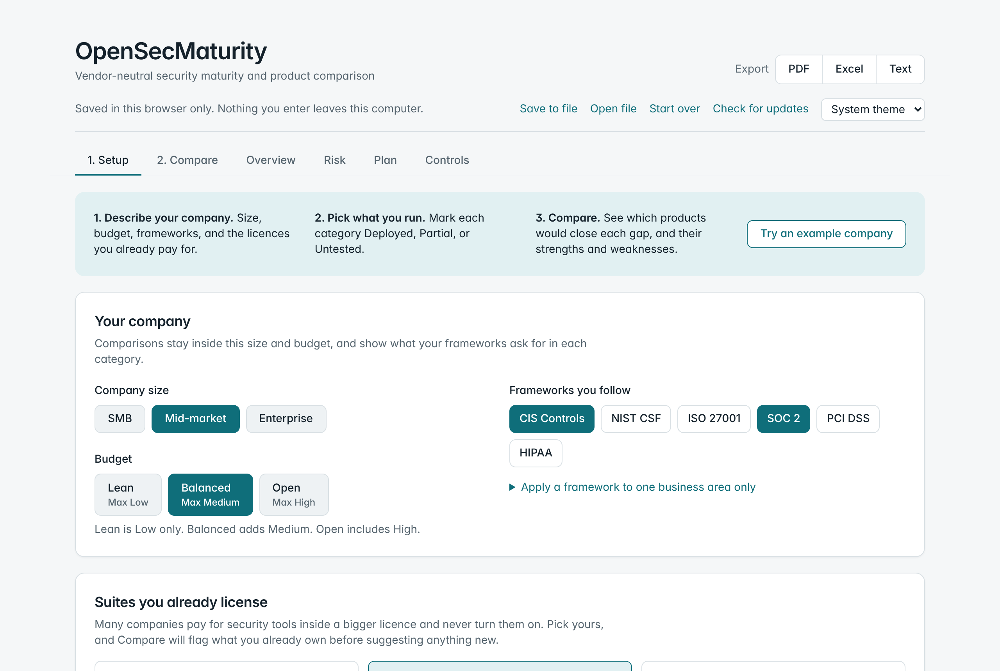

# OpenSecMaturity

A free, open-source way to see where a security program stands and which products are worth a meeting, without sitting through a sales pitch.

Describe your company, pick the frameworks you follow, the licences you already pay for, and the products you run. The app shows which essential categories are covered, what your frameworks require in each gap, and how the products in each category compare: what each would change, where it wins, and where it loses.



## It runs on your computer

There is no server, no account, and no tracking. What you enter is saved in your browser and nowhere else. You can save an assessment to a file, open it again later, or clear it.

The only network requests the app can make come from the optional **Check for updates** button, which reads this public repository and sends nothing about your assessment. A Content-Security-Policy in the page enforces this.

## Get it

**The easy way:** download the latest `.html` file from [Releases](https://github.com/generalwax2018/OpenSecMaturity/releases/latest) and open it in a browser. Each release has a `.sha256` file so you can check the download.

**From source:** you need [Node.js](https://nodejs.org) 20 or newer.

```bash
cd web
npm install
npm run build
```

Then open `web/dist/index.html`. For live reload while developing, run `npm run dev` and open http://127.0.0.1:8080.

Not sure where to start? Click **Try an example company** on the Setup screen.

## What is in it

- **Setup:** company size and budget, frameworks (CIS Controls, NIST CSF, ISO 27001, SOC 2, PCI DSS, HIPAA), licence suites such as Microsoft 365 E3, E5, and E7, the products you run, and the add-ons you have
- **Compare:** for each gap, which products would close it, what each framework requires there, strengths and weaknesses, filters for SaaS or self-hosted, FedRAMP, and EU data residency, and a shortlist of up to three with a one-page PDF
- **Add-ons:** paid modules, higher plans, managed services, and AI features from vendors you already use, with how they are paid for and whether each would raise your maturity or only strengthen what you have
- **Overview, Risk, Plan, and Controls:** score, risk register, 30/60/90-day plan, and control mapping
- **Reports** as PDF, Excel, or text, and inventory import from Excel or CSV



## The catalog

Products, categories, add-ons, and licence suites live in `catalog/` as plain JSON. Every entry cites its sources and the date its facts were checked. Price tiers, strengths, and weaknesses are editorial judgement and are labelled that way. [METHODOLOGY.md](METHODOLOGY.md) explains how verdicts are reached and what they leave out.

Corrections and additions are welcome: use **Suggest a correction** on any product card, or see [CONTRIBUTING.md](CONTRIBUTING.md). [ROADMAP.md](ROADMAP.md) lists good first issues.

## Independence

No vendor pays to be listed, ranked, or described, and there are no referral links. Every change to the catalog is public in the git history, and contributors must disclose any affiliation with a product they edit.

The maintainer works in security operations and is also developing a commercial governance, risk, and compliance product. GRC entries follow the same sourcing rules as every other category, and corrections to them are especially welcome.

## Disclaimer

OpenSecMaturity is guidance, not professional, legal, or audit advice. Framework mappings are the maintainers' reading of the framework texts and do not replace your assessor. Price tiers are rough and are not quotes; confirm current terms with each vendor. Product and company names are trademarks of their owners and are used only to identify the products.

## Licence

App code: [MIT](LICENSE). Catalog data: [CC BY 4.0](catalog/LICENSE.md).

Security issues: see [SECURITY.md](SECURITY.md). Community guidelines: [CODE_OF_CONDUCT.md](CODE_OF_CONDUCT.md).
